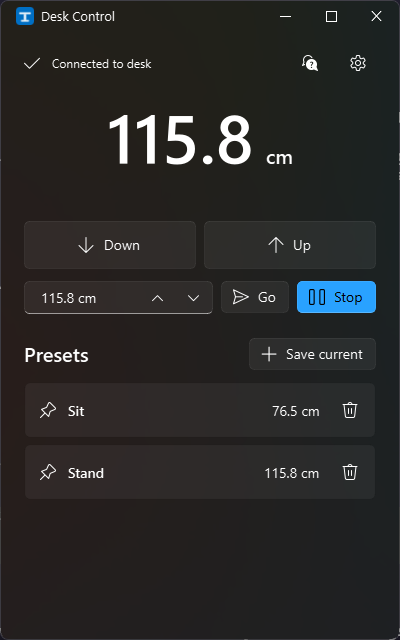
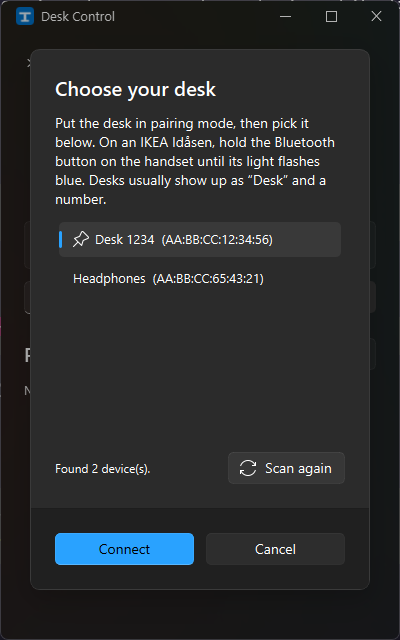

# Desk Control

A small Windows app for Linak Bluetooth standing desks, such as the **IKEA Idåsen**. See and set your desk's
height, save presets, and move the desk to them from the app, the system tray or the Windows 11 Widgets board.

<p>
  
  
</p>

## Features

- Live desk height.
- **Hold Up / Down** to move, like the handset, or type a height and click **Go**.
- **Presets**: save the current height under a name, then move to it with one click.
- **Tray icon** with your presets, Stop and Quit. Desk Control starts in the tray when you sign in, so the desk is
  already connected when you need it.
- **Widgets board widget** (Win+W) showing the height, your presets and Stop.
- **Desk Control box**, optionally: a Home Assistant add-on holds the desk's connection on an always-on box, and
  the app and Alexa use it from there.
- **Alexa**, optionally: “Alexa, set the desk to Stand”, through a smart home skill you host on your own AWS
  account. See [alexa/README.md](alexa/README.md).
- Picks your desk from a list of Bluetooth devices the first time you run it, checks it really is a Linak
  controller, and reconnects to it automatically from then on.

> [!CAUTION]
> This app moves heavy furniture. Make sure nothing (and nobody) is in the way. **Stop**, **Esc** and **Space**
> stop the desk; so does the desk's own handset.

## Requirements

- **Windows 11** with Bluetooth LE. Tested on Windows 11 25H2 with an IKEA Idåsen (Linak DPG controller).
- **Python 3.11 or newer**, for example `winget install Python.Python.3.14`.
- **.NET 10 SDK**, only to build the widget: `winget install Microsoft.DotNet.SDK.10`.
- **Windows App Runtime 1.8**, only for the widget. Most Windows 11 PCs already have it; otherwise get it from
  [Microsoft's downloads page](https://learn.microsoft.com/windows/apps/windows-app-sdk/downloads).

Other Linak desks that show up as “Desk” and a number should work too, but haven't been tested.

## Install

1. Download or clone this repository:

   ```powershell
   git clone https://github.com/steves165/desk-control.git
   cd desk-control
   ```

2. Run the installer in PowerShell:

   ```powershell
   powershell -ExecutionPolicy Bypass -File .\install.ps1
   ```

   It sets up everything for your Windows user only:

   - a Python virtual environment and the app in `%LOCALAPPDATA%\desk-control`,
   - a **Desk Control** Start menu shortcut, and a Startup shortcut so the app starts in the tray when you sign in,
   - the Widgets board widget.

   The widget has to be a signed app package, so the first install creates a self-signed certificate
   (`CN=DeskControl`) and asks you, through a UAC prompt, to trust it on this PC (Local Machine → Trusted People).
   The certificate's private key stays in your user certificate store and can't be exported.

   Options:

   | Option | What it does |
   |---|---|
   | `-SkipWidget` | Don't build or install the widget (no .NET SDK needed, no UAC prompt). |
   | `-NoStartup` | Don't start Desk Control when you sign in. |

   Run the installer again at any time to update: it stops the running app, updates it and starts it again.

## Using Desk Control

### First run: choose your desk

1. Put the desk in **pairing mode**. On an IKEA Idåsen, hold the Bluetooth button on the handset until its light
   flashes blue.
2. Open **Desk Control**. The **Choose your desk** list shows nearby Bluetooth devices, likely desks first. Desks
   usually appear as “Desk” and a number, such as `Desk 1234`.
3. Select your desk and click **Connect**. Desk Control pairs with it and checks it's a Linak desk controller. If
   you pick something else, it tells you and lets you choose again.

Desk Control remembers the desk and connects automatically from then on. Connecting can take up to 30 seconds.
To switch desks later, use **Settings (⚙) → Change desk**.

### Moving the desk

- **Up / Down**: hold to move, release to stop.
- **Go**: type a height in centimetres and click **Go**.
- **Stop**: stops the desk at any time. **Esc** and **Space** do the same.

### Presets

Move the desk to a height you like, click **Save current** and give it a name. Click a preset to move the desk
there; the bin icon deletes it.

### Calibrating the height

The desk only reports how far it is above its lowest position. Desk Control assumes an Idåsen, whose lowest
height is 62 cm. For other desks, or to fine-tune, measure from the floor to the top of the desktop and enter
it in **Settings → Calibrate height**.

### Tray

Closing the window keeps Desk Control running in the tray, connected to the desk. Click the tray icon to open
the window; right-click it for your presets, **Stop** and **Quit**.

To stop it starting when you sign in, disable **Desk Control** in Task Manager → Startup apps, or reinstall with
`-NoStartup`.

### Widget

Press **Win+W**, click **+**, choose **Desk Control** and pin the **Desk** widget (small, medium or large). It
shows the height and your presets while Desk Control is running, and highlights the preset you're at. If Desk
Control isn't running, the widget offers to open it.

### Desk Control box (Home Assistant)

If you have an always-on Home Assistant box near the desk, it can hold the desk's connection instead of your
PC, so Alexa works while the PC is off.

1. In Home Assistant, open **Settings → Add-ons → Add-on store**, then **⋮ → Repositories**, and add
   `https://github.com/steves165/desk-control`.
2. Install the **Desk Control** add-on, start it, and find the pairing key in its **Log** tab.
3. In the app, open **Settings → Desk Control box…** and enter the box's address and the pairing key.

The add-on's Documentation tab covers choosing the desk from the box and moving Alexa over. Without Home
Assistant, run the agent on any always-on machine with Bluetooth: `pip install -r requirements-agent.txt`, then
`python agent.py --data <folder>`.

Help with all of this is also built into the app: click **?** in the top-right corner.

## Troubleshooting

- **Stuck on “Connecting…”**: the desk only accepts one connection at a time. Close the desk's phone app, or
  anything else connected to it. The first connection attempt after starting often fails; Desk Control retries
  on its own.
- **Desk was paired with another computer**: put it in pairing mode again, then use **Settings → Change desk**.
- **Logs**: `%LOCALAPPDATA%\desk-control\desk-control.log`.
- **Settings and presets**: `%APPDATA%\DeskControl\settings.json`.

## Uninstall

```powershell
powershell -ExecutionPolicy Bypass -File .\uninstall.ps1
```

This removes the app, its shortcuts, the widget package and the signing certificate (one UAC prompt). Add
`-KeepSettings` to keep your presets. If you set up Alexa, see [Removing it](alexa/README.md#removing-it) too. To unpair the desk, remove it in Settings → Bluetooth & devices.

## How it works

| Path | What it is |
|---|---|
| `app.py` | The app: PySide6 with [PySide6-Fluent-Widgets](https://github.com/zhiyiYo/PyQt-Fluent-Widgets) for the Fluent design, asyncio via qasync. |
| `desk.py` | Linak Bluetooth LE protocol, using [bleak](https://github.com/hbldh/bleak). |
| `ipc.py` | Named pipe `\\.\pipe\DeskControl` (current user only), used by the widget and installer to talk to the running app. |
| `icons.py` | Draws the app, tray and widget icons. |
| `widget/` | Widgets board provider in C# (Windows App SDK 1.8, out-of-process COM server), packaged as a signed MSIX by `build.ps1`. |
| `alexa_link.py`, `alexa/` | Optional Alexa skill: the app's MQTT link to AWS IoT Core, the skill's Lambda function and its Terraform. See [alexa/README.md](alexa/README.md). |
| `agent.py`, `remote.py` | The desk agent for an always-on box, and the app's client for it (protocol in `remote.py`). |
| `desk-agent/`, `repository.yaml` | The Home Assistant add-on that runs the agent. |
| `probe.py` | Developer tool: pairs with a desk and lists its Bluetooth services. |
| `install.ps1` / `uninstall.ps1` | Installer and uninstaller. `install.sh` runs `install.ps1` from WSL. |

Only one copy of the app runs at a time, because the desk accepts a single Bluetooth connection. The widget
never connects to the desk itself; it sends commands to the app over the named pipe.

### Linak protocol notes

| Characteristic | Use |
|---|---|
| `99fa0021-…` (notify/read) | Position (`uint16`, 0.1 mm above the lowest point) and speed (`int16`). |
| `99fa0002-…` (write) | Commands: `FE 00` wake up, `FF 00` stop. |
| `99fa0031-…` (write) | Target position (`uint16`). Keep writing it, about every 0.4 s, while the desk moves. |

The controller stops dead if the target changes during a move, so hold-to-move uses one far-away fixed target
and sends Stop on release. Connecting from Windows takes 5–30 seconds, which is why the app keeps one
long-lived connection.

## Development

- Run from source after installing: `%LOCALAPPDATA%\desk-control\venv\Scripts\python.exe app.py`. Quit the
  installed copy first (tray → Quit); otherwise the second copy just brings the first one to the front.
- Rebuild only the widget: `.\widget\build.ps1 -Python "$env:LOCALAPPDATA\desk-control\venv\Scripts\python.exe"`.
- Tests: `pip install -r requirements-agent.txt boto3 pytest`, then `python -m pytest tests alexa/lambda`. CI runs
  them and builds the add-on's image on every push.
- Releasing the add-on: bump `version` in `desk-agent/config.yaml`, push, and tag the commit `agent-v<version>`;
  Home Assistant builds the add-on from that tag.
- Developing in WSL: `./install.sh` (Bluetooth is only reachable from the Windows side).
- PySide6 is pinned to 6.11.2: in 6.12, PySide6-Fluent-Widgets' spin boxes lay out their text field 1 px wide.

## Licence

[GPL-3.0](LICENSE), because Desk Control uses PySide6-Fluent-Widgets, which is licensed under GPLv3.

Desk Control isn't affiliated with or endorsed by IKEA or Linak. The protocol details come from the community's
reverse engineering of Linak controllers, such as [linak-controller](https://github.com/rhyst/linak-controller).
